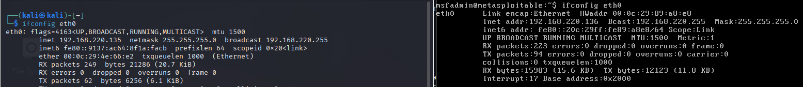
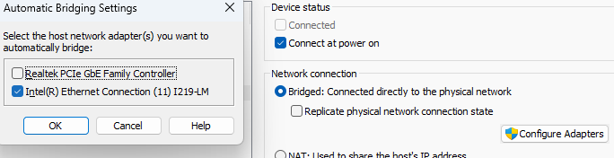
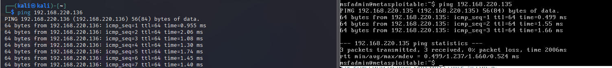
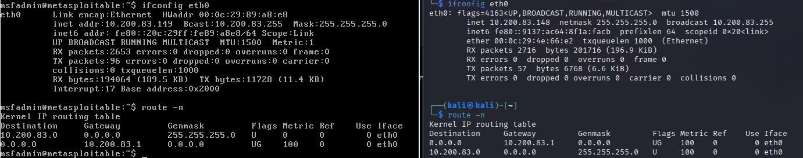
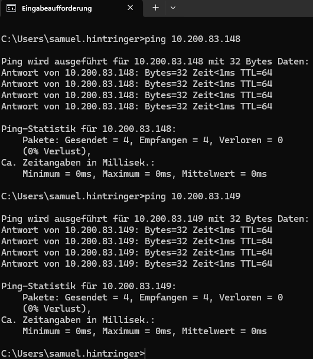
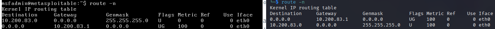
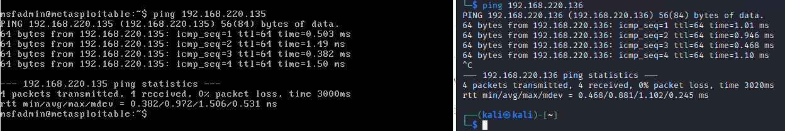
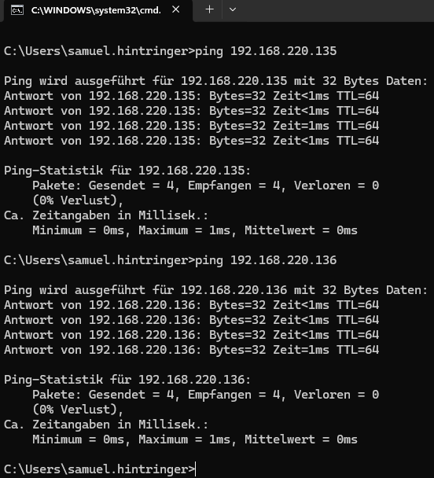

# Arbeitsbericht

- Name: Samuel Hintringer
- Fach: ITSI-Übunugen
- Datum: 10.11.2026
- Klasse: 2AHITS
- Aufgaben: Ü2 Networking zwischen Kali und Metasploitable
- Source: https://www.franzmatejka.at/htl/doc/ITSI_3/itsi3-lab/02_network.html

## Ü2: Info - IP Adresse ermitteln

## Ü2.1: Netzwerk NAT/Bridged

### Bridged:

### NAT:

