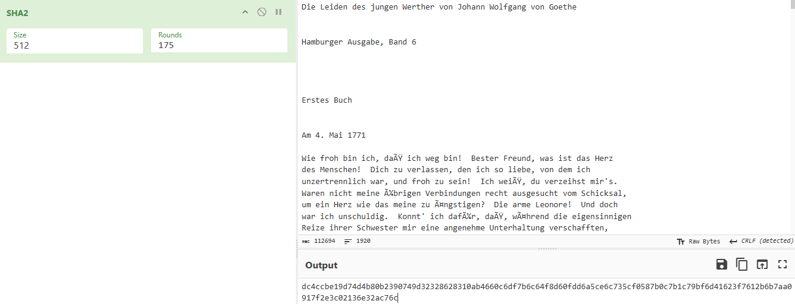

# Arbeitsbericht

- Name: Samuel Hintringer
- Fach: ITSI-Übunugen
- Datum: 24.11.2026
- Klasse: 3AHITS
- Aufgaben: Hashing und Encoding
- Source: [text](https://www.franzmatejka.at/htl/doc/ITSI_3/itsi3-lab/03_hashing_encoding.html)

## 3.3 SHA256 mit Cyberchef

